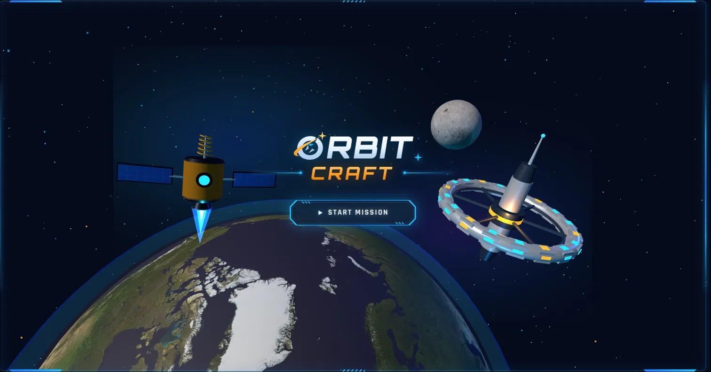
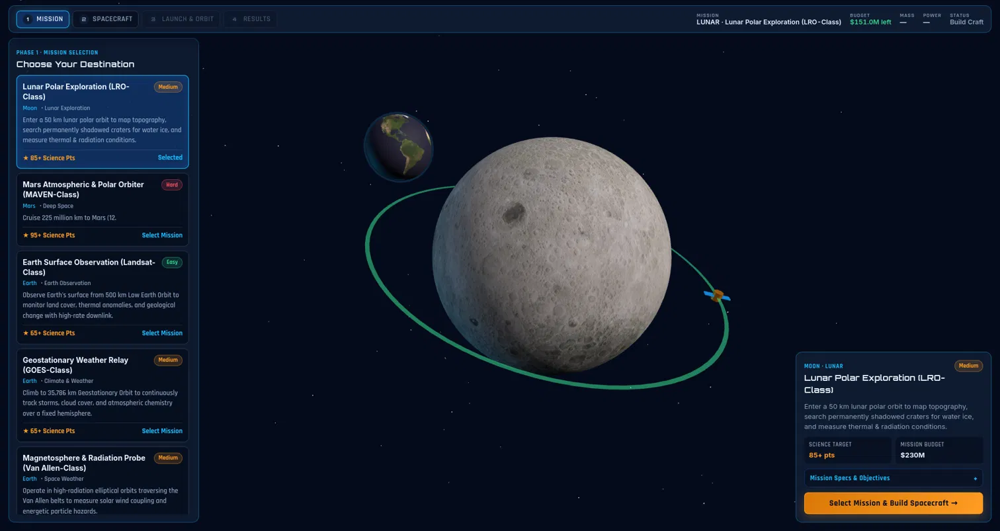
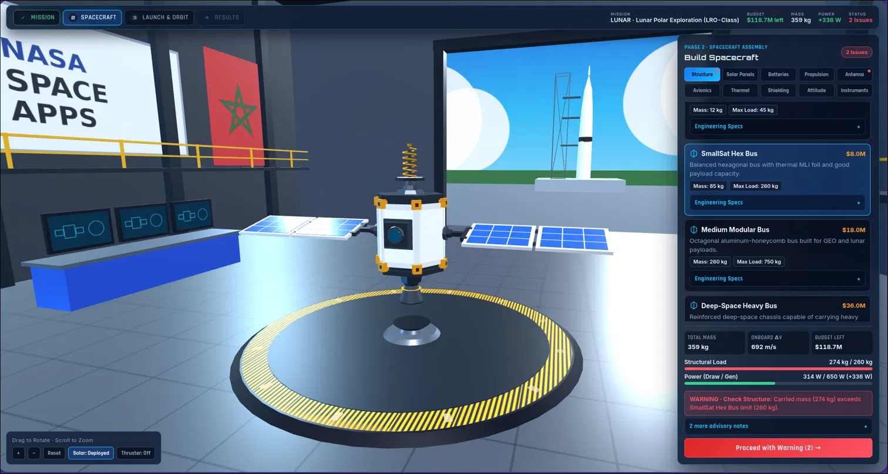
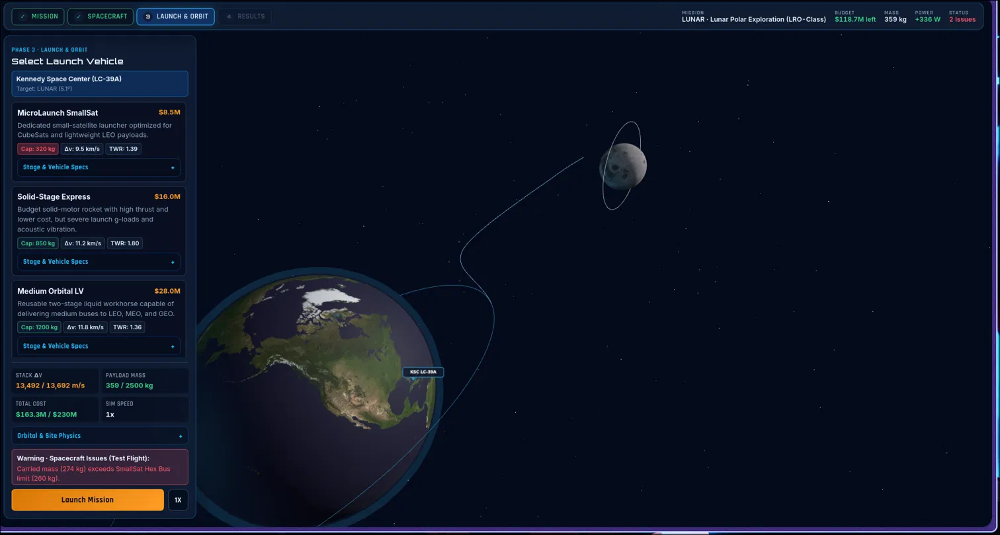
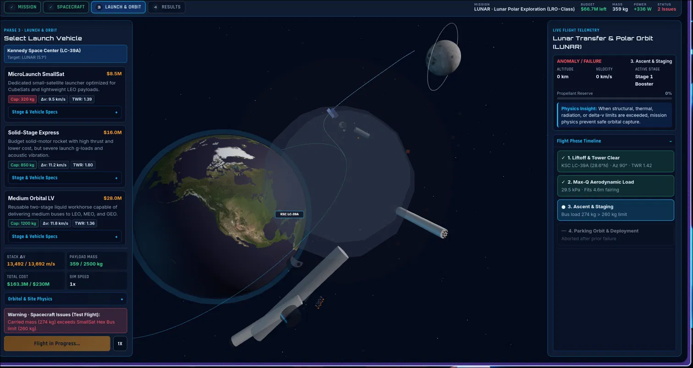
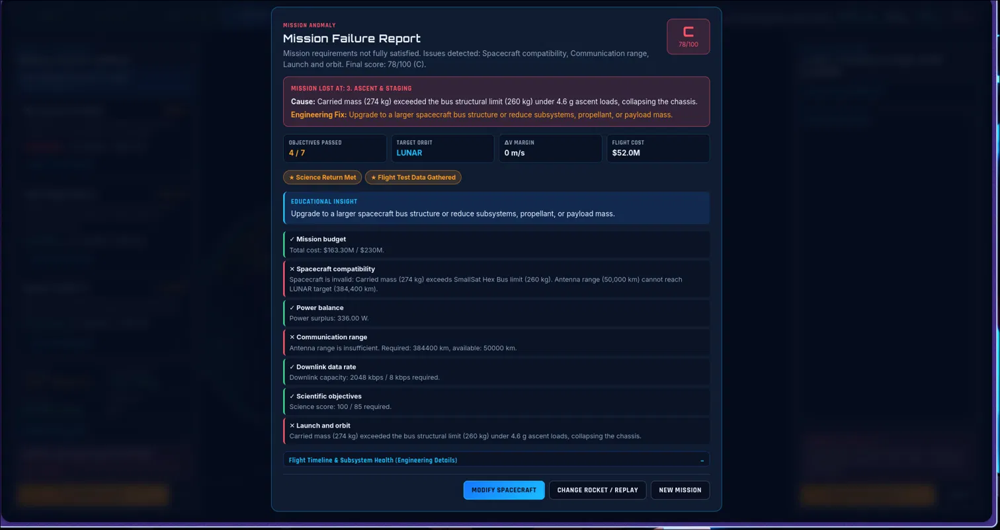

# ORBIT CRAFT — Space Mission Design Game

**2026 NASA Space Apps Challenge**

An interactive 3D aerospace engineering & space mission simulation game built with **Three.js** and **Vite**. Players design, assemble, launch, and evaluate end-to-end space missions while balancing real-world engineering trade-offs across **budget, structural mass, power generation, communications range, downlink data rate, thermal/radiation limits, and orbital mechanics ($\Delta v$)**.



---

## Gameplay & 4-Phase Mission Flow

Players progress through four connected engineering phases:

### 1. Mission & Science Planning
Choose a target destination and mission profile—such as **Lunar Polar Exploration (LRO-Class)**, **Mars Atmospheric & Polar Orbiter (MAVEN-Class)**, **Earth Surface Observation (Landsat-Class)**, **Geostationary Weather Relay (GOES-Class)**, or **Magnetosphere & Radiation Probe (Van Allen-Class)**—and inspect target orbit, science point goals, and mission budget.



### 2. Spacecraft Assembly (Kennedy Space Center Integration Hangar)
Configure a 3D spacecraft in the integration bay across **10 subsystem categories**:
- **Structure** (bus chassis & structural load limits)
- **Solar Panels** (deployable power generation)
- **Batteries** (energy storage)
- **Propulsion** (onboard $\Delta v$, dry/propellant mass, thrust)
- **Antenna** (communications range & downlink kbps)
- **Avionics**, **Thermal**, **Shielding**, **Attitude Control**, and **Science Instruments** (payloads integrated inside the spacecraft bus)

Real-time gauges track total mass, structural load, power balance, onboard $\Delta v$, and remaining budget, surfacing live compatibility errors and warnings before rollout.



### 3. Launch & Orbit Simulation
Select a launch vehicle at **Kennedy Space Center (LC-39A)**, verify fairing fit, payload mass capacity, and total stack $\Delta v$ (including Earth-rotation bonus and inclination plane-change costs), and watch the real-time 3D launch, staging, and orbital transfer—complete with live flight telemetry, time-warp (`1x` / `10x` / `100x`), and physics-driven anomaly/failure simulation if limits are exceeded.

| Pre-Launch & Transfer Arc | Live Flight Telemetry & Staging |
| :---: | :---: |
|  |  |

### 4. Mission Evaluation & Engineering Report
Receive a scored mission report (`0–100` grade) with a 7-point engineering checklist (Mission Budget, Spacecraft Compatibility, Power Balance, Communication Range, Downlink Data Rate, Scientific Objectives, and Launch & Orbit), root-cause failure diagnostics, and actionable engineering fix recommendations.



---

## Key Features

- **Real Orbital Mechanics:** Computes orbital velocity ($v = \sqrt{\mu / r}$), escape velocity, orbital period, Hohmann transfer $\Delta v$, Tsiolkovsky rocket equation ($\Delta v = I_{sp} g_0 \ln(m_0 / m_f)$), and KSC LC-39A launch azimuth / Earth-rotation bonuses.
- **Interactive 3D Scenes:** Start screen orbital vista, 3D planetary mission previews (Earth, Moon, Mars), KSC integration hangar with deployable solar wings and thruster previews, and full 3D launch-to-orbit animation.
- **Procedural & GLB 3D Assets:** Uses Three.js procedural spacecraft/planet/instrument builders alongside `.glb` models and Draco decompression.
- **Guided Onboarding & Audio:** First-run spotlight tour, phase-aware engineering hints, local high-score persistence (`localStorage`), and synthesized Web Audio sound effects with mute toggle.

---

## Tech Stack

| Tool | Purpose |
| :--- | :--- |
| **Three.js (`^0.170.0`)** | 3D rendering engine (`WebGLRenderer`, procedural meshes, GLB/Draco models, `OrbitControls`) |
| **Vite (`^6.0.0`)** | Fast local development server and production bundler |
| **Node.js (`node:test`)** | Built-in zero-dependency unit and 3D assembly test runner |
| **Docker & Docker Compose** | Reproducible `node:24-alpine` dev environment and Nginx production container |
| **Vercel** | Static production hosting for `dist/` |

---

## Getting Started

You can run the project either with **Docker** (no local Node.js required) or directly with **Node.js** (`v20+` / `v24` recommended).

### Option A: Using `Makefile` (Recommended — auto-detects Docker or local Node)

```bash
make up        # Start Vite dev server and open http://localhost:5173
make dev       # Start Vite dev server in foreground with live logs
make down      # Stop the dev server
make test      # Run all unit & 3D assembly tests
make check     # Syntax-check all JavaScript files under src/
make build     # Build production bundle into dist/
```

Run `make help` to see all available targets.

### Option B: Docker Compose

```bash
docker compose up       # Start dev server on http://localhost:5173
docker compose down     # Stop the dev server
```

> **Linux rootless Docker:** If Docker reports a socket permission error, initialize rootless Docker with `dockerd-rootless-setuptool.sh install` and ensure `DOCKER_HOST=unix:///run/user/$(id -u)/docker.sock` is set.

### Option C: Local Node.js & npm

```bash
npm install
npm run dev             # Starts Vite dev server (http://localhost:5173)
```

---

## Testing & Verification

The project uses Node's built-in test runner (`node --test`):

```bash
# Run all module test suites
node --test src/modules/**/__tests__/*.test.js

# Or via Make
make test
make test-spacecraft    # Spacecraft design module tests only
make check              # Syntax-check all src/**/*.js files
npm run build           # Verify production Vite bundle
```

---

## Architecture & Folder Structure

```text
NASA_SPACE_APPS_CHALLENGE/
├── public/
│   ├── draco/gltf/              # Draco mesh decoder/encoder WASM & JS
│   ├── images/                  # Gameplay & UI preview screenshots (.webp)
│   ├── models/                  # Static 3D models (.glb)
│   │   ├── instruments/
│   │   └── space_craft.glb
│   └── textures/                # Planetary surface textures (Earth, Moon, Mars)
├── src/
│   ├── main.js                  # Application bootstrap
│   ├── core/
│   │   ├── SceneManager.js      # Shared Three.js Scene, Camera, Renderer, resize loop
│   │   └── GameState.js         # Central reactive pub/sub state store
│   ├── modules/
│   │   ├── mission-science/     # Member 1: missions, instruments, planets, MissionEvaluator
│   │   ├── spacecraft-design/   # Member 2: component DB, 3D hangar & assembly, compatibility
│   │   ├── launch-orbit/        # Member 3: rockets, orbits, delta-v physics, 3D launch
│   │   └── game-interface/      # Member 4: phase flow, HUD, tour, onboarding, results modal
│   ├── shared/
│   │   ├── data/                # Shared physical/game constants (constants.js)
│   │   ├── i18n/                # Localization strings & helpers
│   │   ├── interfaces/          # Cross-module contracts (MissionSpec, SpacecraftSpec, GameModule)
│   │   └── utils/               # AssetLoader, SoundEffects, formatters
│   └── styles/
│       └── main.css             # Global layout and UI theme variables
├── index.html
├── package.json
├── Makefile                     # Unified Docker / local Node workflow commands
├── Dockerfile                   # Multi-stage production Nginx build
├── compose.yaml                 # Local Node 24 Docker dev server
├── tasks.md                     # Detailed A-to-Z tasks per team member
├── LICENSE
└── README.md
```

## Deployment

### Vercel
1. Import the GitHub repository into **Vercel**.
2. Use the **Vite** preset:
   - **Framework:** `Vite`
   - **Install command:** `npm install`
   - **Build command:** `npm run build`
   - **Output directory:** `dist`

### Production Docker (Nginx)
```bash
make prod-up
# or manually:
docker build -t space-mission-game .
docker run --rm -p 8080:80 space-mission-game
```

---

## Resources & License

- **Event:** 2026 NASA Space Apps Challenge —  [*Space Mission Design Game*](https://www.nasa.gov/wp-content/uploads/2025/04/250323-design-and-develop-science-mission.pdf?emrc=a454cf)
- **NASA 3D Resources:** https://science.nasa.gov/3d-resources/
- **License:** See [LICENSE](./LICENSE)
